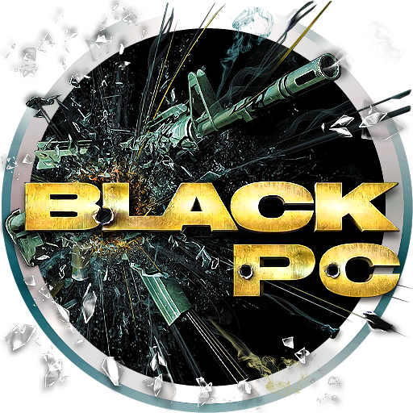

<p align="center"></p>

# BlackDefinitiveHDPC

**BlackDefinitiveHDPC** by **Spring — Spring Code**

An unofficial native Windows port (and playable on Linux) of **BLACK** (Criterion Games, 2006), made from the original
Xbox version (NTSC-U).

`black.exe` loads your own copy of the game's `default.xbe` and runs the original x86 game code directly on the PC; the
parts of the Xbox it talks to (kernel, Direct3D 8, DirectSound, controller library) are replaced by PC code.

**You need your own copy of the game. This repository and the release downloads contain no game code or data.**

## What BlackDefinitiveHDPC adds

| Area | Improvement |
|---|---|
| Frame rate | 30, 60, **120**, 144, 165 or 240 fps (default **120**). Frame pacing rebuilt so high rates no longer run in slow motion; short waits stay accurate even on PCs with coarse system timers. **Frameskip**: when the PC cannot keep the chosen rate (a heavy scene, a high draw distance, another program busy), the game keeps running at real speed and skips drawing some frames instead of going into slow motion. |
| Physics at high frame rates | Ragdolls, glass, recoil, weapon sway and aim zoom behave as at 30 fps; corpses and dropped weapons no longer freeze in mid-air. |
| Crosshair | **HD crosshair**: the HUD texture rebuilt at 4x from your own game files with a sharp dot (white disc, black outline), mipmapped so the outline never flickers away. Colours set in `black.ini`: **green** normally, **blood red** over an enemy, and **black** over an object that can explode (as in the original game). |
| Aiming | **Hold to aim** (aim while the button is held) or the original toggle, in PC SETTINGS > CONTROLS > AIM. |
| Aim assist | AUTO-AIM: OFF, ON or **CONTROLLER ONLY** (default), in PC SETTINGS > CONTROLS: the pull towards enemies works with a controller and switches off as soon as the keyboard or mouse is used. |
| Crouch | **Hold to crouch** (crouch while Ctrl is held), whatever the game profile says, in PC SETTINGS > CONTROLS > CROUCH. |
| Weapons | Keys **1** and **2** select the first or second weapon you carry; **Q** swaps between them. |
| Walk | **Shift** to walk slowly, at 25% of full speed (`walk_speed` in `black.ini`). |
| Audio | First start (no saved profile yet): sound effects at 60% and music at 40% in the game's audio settings. |
| Prompts | Follow the device in use: your bound keys with keyboard and mouse ("Press [F] to pick up", [ENTER] confirm), the controller's buttons with a controller, switching at once. |
| Menus | Controller options readable in the Portuguese translation (YES / NO instead of overlapping ON / OFF words). |
| Ambient occlusion | **SSAO** or **GTAO** (off by default), in PC SETTINGS > MODS. |
| Controller | **Controller sensitivity** (right stick), in PC SETTINGS > INPUT. |
| Mouse in menus | The row under the cursor is highlighted; left click confirms (or changes the value), right click goes back, the wheel scrolls. The keyboard keeps the highlight until the mouse is moved. |
| Mods | A `game\mods\` folder: each mod is a folder whose `game\` files replace the game's. PC SETTINGS > MODS turns each one on or off; the game restarts by itself when you return to the main menu. |
| Field of view | Field of view (default **100**) and **weapon field of view** (default **85**) side by side in PC SETTINGS > AUDIO AND GAME. |
| HUD | With the 16:9 aspect ratio the HUD's corner panels keep their original shape instead of being stretched; at 4:3 the HUD is the original. |
| FPS counter | Optional frame rate counter on screen (off by default). |
| Subtitles | Optional movie subtitles in the language being played (**off** by default). |
| Graphics | Anisotropic filtering (default **16X**), window size (default **1080p**) and resolution scale (default **4X**). |
| HD texture pack | Uses a PCSX2 texture pack of the PS2 version (currently *BLACK_HD_Reimagined_Texture_Pack*, in `game\mods\replacements`): each game texture is matched to its HD version by its picture, the first time it is seen, and loaded into video memory. Unmatched textures stay as they are. |
| Textures | Texture replacement: a PNG in `game\textures\` named after a game texture replaces it (any size, mipmapped). `--dump-textures` saves the game's textures to `game\textures\dump\` to find their names. |
| Performance | Accurate frame pacing above 60 fps without a busy core: the game's vertical blank runs at the chosen rate on a separate CPU. |
| Draw distance | Level of detail and draw distances **1X** (the game's, default), 2X, 4X, 8X, 12X or 16X, in PC SETTINGS > MODS. See *Performance notes*. |
| Language | English, Brazilian Portuguese, Spanish, French, German, Italian, Indonesian or Russian (game text, menus and subtitles), in PC SETTINGS > INPUT (from the next start). |
| Input | INPUT DEVICE: **AUTOMATIC** (default), **MOUSE/KEYBOARD** or **CONTROLLER** prompts, in PC SETTINGS > INPUT. |
| Camera and effects | Camera shake on explosions (on by default) and the reload blur (off by default) can be turned on or off in PC SETTINGS > MODS. |
| V-Sync | Optional, in PC SETTINGS > MODS (off by default). |
| Cheats | PC SETTINGS > CHEATS: **UNLOCK ALL** (every mission on every difficulty, the Black Ops difficulty, the M16A2 and the silver weapons with unlimited ammo, as a 100% profile; saved with the profile, so it stays after the cheat is turned off), **GOD MODE** and **INFINITE HEALTH PACKS**. The game's own BFG profile-name codes still work. |
| Settings shortcut | **F1** opens PC SETTINGS from play, the pause menu or the main menu. |
| Saved games | Use a saved game from an Xbox (or from another language of the game): put its folder in `game\savedata\Partition1\UDATA\45410083\` (the folder with `SaveMeta.xbx` and the profile file inside). At the next start the port signs it again for the PC and, if it was made in another language ("Profile" / "Perfil"), renames it to the language being played, so the game loads it. |

Plus everything of the base port: any render resolution, anti-aliasing, widescreen, adjustable field of view, mouse
look, bindable keys, XInput controllers, borderless fullscreen, settings in the game's own menus.

## Requirements

- Windows 10 or 11, a graphics card with Direct3D 9 (Shader Model 3).
- Nothing else has to be installed.
- The **NTSC-U** (North America) Xbox disc of BLACK. Other regions and builds are not supported.

## Installing

1. Dump your disc and extract it with [extract-xiso](https://github.com/XboxDev/extract-xiso): it makes a `game` folder
   with the game's files. Only the NTSC-U build works: `game\default.xbe` must have SHA-256
   `DF2739C372D254A90AEECCF5971D12097F22D89FBB90DB021FDA96DD4DEB68F6`
   (PowerShell: `Get-FileHash game\default.xbe -Algorithm SHA256`).
2. Extract `BlackDefinitiveHDPCv1.4.2.zip` into the `game` folder:

   ```
   game\
     default.xbe
     ...
     black.exe
     blackrt.dll
     black.ini
     mods\
   ```

3. Start `game\black.exe`.

The port keeps saved games (`savedata\`), settings (`black.ini`), the log (`black.log`) and its menu files (`cache\`)
in the `game` folder; the game's own files are never changed. A translated copy of the game (for example the
Portuguese translation) works the same way, as long as `default.xbe` is the NTSC-U one.

### Optional: HD texture pack

No textures are included. BlackDefinitiveHDPC currently uses the **BLACK_HD_Reimagined_Texture_Pack** (PCSX2 texture pack of
the PS2 version, SLUS-21376). Download it and put its `replacements` folder inside `game\mods`:

```
game\
  mods\
    replacements\
      ...the pack's .dds / .png files
```

Or write the pack's path in `black.ini` (`texture_pack = C:\...`). The first start indexes the pack (a few seconds,
cached in `game\cache`). `game\cache\texpack.map` lists every match; changing a line's file to `-` keeps the game's
own texture there. PC SETTINGS > MODS > TEXTURES turns the pack on or off (from the next start).

## Controls (keyboard and mouse)

| Action | Key |
|---|---|
| Move | W A S D |
| Walk slowly (hold) | Shift |
| Look | mouse |
| Fire / Aim (hold) | left / right mouse button |
| Reload | R |
| Use, pick up | F |
| Crouch (hold) | Ctrl |
| Grenade | G |
| Melee | V |
| Weapon 1 / Weapon 2 | 1 / 2 |
| Swap weapon | Q or mouse wheel |
| Change firing mode | Z |
| Toggle suppressor | T |
| Health pack | X |
| Show objectives | Tab |
| Pause | Esc |
| PC SETTINGS (from play, the pause menu or the main menu) | F1 |

Menus: arrow keys, Enter to confirm, Backspace to go back, or the mouse (left click confirms, right click goes back,
the wheel scrolls). Every key can be changed in
PC SETTINGS > CONTROLS > KEY BINDINGS (two keys per action). Controllers work as well.

## Settings

In the game: Options > PC SETTINGS (main menu) and PC SETTINGS in the pause menu.

| Page | Settings |
|---|---|
| VIDEO | render resolution, window size, resolution scale, anti-aliasing, anisotropic filtering, fullscreen |
| DISPLAY | aspect ratio, frame rate (both apply from the next start), geometry seam fill, effects at Xbox size, brightness, gamma |
| AUDIO AND GAME | room reverb, skip any movie, movie subtitles, FPS counter, field of view, weapon field of view |
| CONTROLS | mouse sensitivity, mouse inversion, auto-aim (off / on / controller only), aim (hold / toggle), crouch (hold / profile option), key bindings |
| MODS | camera shake, reload blur, V-Sync, HD textures (from the next start), ambient occlusion, draw distance |
| INPUT | input device (automatic, mouse/keyboard or controller prompts), controller sensitivity, language (from the next start) |
| CHEATS | unlock all, god mode, infinite health packs |

The aspect ratio is only on the main menu's pages; everything else is also in the pause menu.

First start (no `black.ini` settings yet): 120 fps, window 1080p, resolution scale 4X, anisotropic filtering 16X,
field of view 100, weapon field of view 85, HD crosshair, hold to aim and crouch, auto-aim for the controller only,
subtitles and FPS counter off, camera shake on, reload blur off, V-Sync off, HD textures on, ambient occlusion off,
English, draw distance 1X, prompts following the device in use, controller sensitivity 1.

### Performance notes

The game runs well with high settings: high frame rates, resolution scale, HD textures and ambient occlusion.

- **Draw distance** is the one setting that still lowers the frame rate a little at 2X and above, mostly in open areas.
  If the PC cannot keep up, the frameskip keeps the game at real speed (`black.exe --no-frameskip` turns it off).
- **Weaker graphics cards**: lower the resolution scale, or use SSAO instead of GTAO.
- **Weaker PCs**: on the first start with integrated graphics the game picks a light setup by itself, and lowers the
  resolution scale during that first session if it cannot keep 60 fps.
- **Optional**: `extras\DXVK\d3d9.dll` (DXVK, Vulkan) next to `black.exe` can run faster on some integrated graphics;
  delete it to go back.

Also in `game\black.ini`:

| Key | Meaning |
|---|---|
| `hd_reticle = 1` | the HD crosshair (0 = the game's) |
| `reticle_colour = 00FF00` | crosshair colour (RRGGBB, or `game`) |
| `reticle_enemy_colour = 8C0000` | crosshair colour over an enemy |
| `walk_speed = 0.25` | share of full speed while walking (0.1 to 1.0) |
| `crouch_hold = 1` | crouch while the key is held |
| `aim_hold = 1` | aim while the key is held |
| `autoaim = 2` | 0 off, 1 on, 2 controller only |
| `texture_pack =` | folder of an HD texture pack (empty = `game\mods\replacements`, `off` = none) |
| `texture_pack_max = 2048` | largest pack texture size loaded (bigger ones use a smaller mip) |
| `fov = 100.0` | field of view in play (70 = the game's) |
| `viewmodel_fov = 85.0` | weapon field of view (70 = the game's) |
| `aniso = 16` | anisotropic filtering (0 = the game's filters, 2, 4, 8 or 16) |
| `window = 0x1080` | window size (`WIDTHxHEIGHT`; width 0 = from the aspect ratio) |
| `fpscounter = 0` | frame rate counter on screen |
| `subtitles = 0` | `.srt` subtitles over the movies |
| `camera_shake = 1` | the view shakes at explosions |
| `reload_blur = 0` | the reload's depth blur |
| `vsync = 0` | V-Sync |
| `textures = 1` | the HD texture pack in `game\mods\replacements` |
| `language = en` | `en`, `ptbr`, `es`, `fr`, `de`, `it`, `id` or `ru` |
| `draw_distance = 1` | 1, 2, 4, 8, 12 or 16 |
| `ambient_occlusion = off` | `off`, `ssao` or `gtao` |
| `input_mode = auto` | `auto` (the device in use), `keyboard` or `controller` prompts |
| `pad_sens = 1.000` | controller (right stick) sensitivity |
| `cheat_unlock_all = 0`, `cheat_god = 0`, `cheat_health_packs = 0` | the CHEATS page |
| `skip_intro = 1` | skip the logo, credits and intro films at start (straight to PRESS START, then the main menu) |

`black.exe --help` lists the command-line options.

## Building from source

Visual Studio 2022 or 2026 (Build Tools are enough) with the C++ x86 tools, and CMake 3.24 or newer (it ships with
Visual Studio).

```
cd loader
cmake --preset win32-vs2022     # or win32 for Visual Studio 2026
cmake --build build/win32-vs2022 --config RelWithDebInfo
```

This builds `black.exe` and `blackrt.dll`.

## Credits

**BlackDefinitiveHDPC** — Spring, **Spring Code**: all the improvements listed above.

**Icon and artwork** — Gary aka **POOTERMAN** ([deviantart.com/pooterman](https://www.deviantart.com/pooterman)).

### Projects studied

- black-pc by Spark198rus — native Windows port of BLACK, compared for features.
- black-pc-modloader by Darketz — mods, mouse in the menus, FPS counter, movie subtitles, 16:9 HUD and weapon field of
  view, adapted from its code.
- BLACK-XBERecomp by TGP482 — another PC version of BLACK (static recompilation), studied and compared for features.
- BLACK-SUBTITLES by soldieg — translations and subtitles.
- Cxbx-Reloaded and xemu — references for how the Xbox kernel and the NV2A graphics chip behave (no code copied).
- XbSymbolDatabase (Cxbx-Reloaded) — identifies the Xbox library functions in the game.
- nxdk (XboxDev) — its headers document the Xbox kernel's types.

### Tools used

- Ghidra (NSA) with ghidra-xbe (XboxDev) — disassembly and decompilation of the game.
- extract-xiso (XboxDev) — extracts the game from the disc image.
- Visual Studio Build Tools and CMake (Microsoft / Kitware) — building the port.
- Git, Node.js and Eclipse Temurin (OpenJDK) — the development environment.

## License

BlackDefinitiveHDPC is free software under the GNU General Public License, version 2 or (at your option) any later version,
like the project it is based on. See `LICENSE`.

## Legal

This project is not affiliated with or endorsed by Criterion Games or Electronic Arts. BLACK is a trademark of
Electronic Arts Inc.; Xbox is a trademark of Microsoft Corporation. No code or data from the game and no code from the
Microsoft Xbox Development Kit is included. You need your own legally obtained copy of the game.
